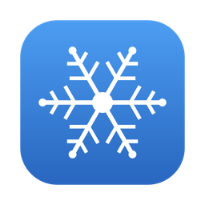
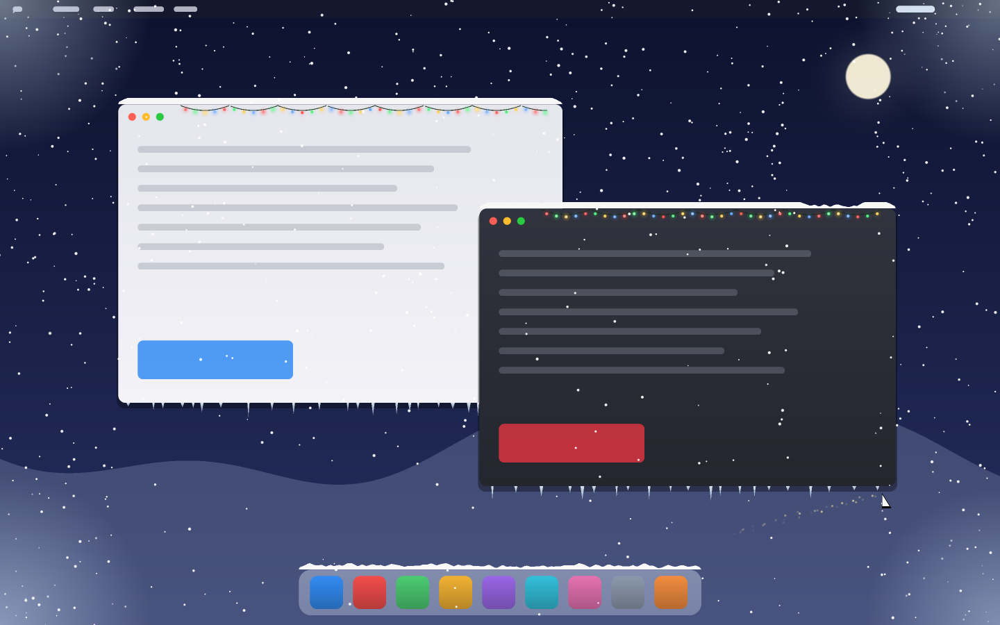

<div align="center">



# SnowDesk

**Let it snow on your Mac.** Snow falls over every app, piles up on your windows and the Dock, and reacts to what you do.

[](https://github.com/iystoychev/snowdesk/releases/latest)
[](https://github.com/iystoychev/snowdesk/actions/workflows/ci.yml)


[](LICENSE)

**[⬇ Download the latest release](https://github.com/iystoychev/snowdesk/releases/latest)** · free · no permissions · open source



<sub>Preview rendered by the app's own snow engine on a mock desktop.</sub>

</div>

## Why you'll like it

- ❄️ **Snow that sticks.** It piles up on window tops and the Dock, and stays put when you switch desktops or open Mission Control.
- 🪟 **It reacts.** Resize a window and the snow falls off; fling one and the snow flies off at its speed; sweep the cursor to brush it away.
- 🎄 **Christmas extras.** Twinkling lights, growing icicles, wind gusts, cursor sparkles, frosted corners and a countdown to Christmas.
- 🔒 **No permissions, no tracking.** No Screen Recording, no Accessibility, no network. It never sees what's in your windows.
- 🔋 **Light.** Drawn on the GPU with Metal: about 5% CPU, and videos underneath keep playing smoothly.
- 🆓 **Free and open source.** MIT licensed. No subscription.

## What it does

- **Resize a window** and its snow falls off.
- **Fling a window** and its snow flies off at the window's speed.
- **Run the cursor along a pile** to brush the snow off, including off the Dock.

Christmas decorations come with it:

- **Christmas lights** hang in sagging strings along each window's top edge and twinkle in a chasing pattern. They start after the window's traffic-light buttons.
- **Icicles** slowly grow under each window's bottom edge. A resize or fling snaps them off.
- **Wind gusts** blow all the snow sideways every so often.
- **Cursor sparkles**: moving the mouse leaves a short trail of glints.
- **Frosted corners**: frost creeps in from the screen corners over a few minutes, and melts when the cursor goes near.
- **Countdown**: the menu bar item shows the days left until Christmas ("❄︎ 50d"), and a tree on the day.

It needs **no permissions**: no Screen Recording and no Accessibility. It only reads window positions (never titles or contents), the cursor position, and the Dock's preferences.

## Install

### Download

1. Download `SnowDesk-<version>.zip` from the [latest release](https://github.com/iystoychev/snowdesk/releases/latest). It runs on Apple Silicon and Intel Macs with macOS 13 or newer.
2. Double-click the zip, then drag **SnowDesk** into your Applications folder.
3. The first time, open it with **right-click → Open**, then **Open** in the dialog. The app is not notarized by Apple, so a plain double-click only shows a warning the first time. If macOS still refuses, run:

   ```bash
   xattr -dr com.apple.quarantine /Applications/SnowDesk.app
   ```

4. Look for ❄︎ in the menu bar (there is no Dock icon) and turn on **Start at Login** if you want it every day.

### Build from source

You need [Go](https://go.dev/dl/) 1.27 or newer and the Xcode Command Line Tools (cgo needs them for the Cocoa and Metal parts):

```bash
xcode-select --install
```

1. Build the app and put it in your Applications folder:

   ```bash
   git clone https://github.com/iystoychev/snowdesk.git
   cd snowdesk
   make install
   ```

   This builds `SnowDesk.app` (signed for this Mac) into `build/` and copies it to `/Applications`.

2. Open **SnowDesk** from Applications, Launchpad or Spotlight. It has no Dock icon: look for ❄︎ in the menu bar.

3. Click ❄︎ and turn on **Start at Login**. From the next login on, macOS starts SnowDesk by itself.

### Update

If you downloaded it, download the new release and replace the app in Applications. If you built it:

```bash
cd snowdesk
git pull
make install
```

Then quit SnowDesk from the ❄︎ menu and open it again. Start at Login keeps working, because the app stays in the same place.

### Uninstall

1. In the ❄︎ menu, turn off **Start at Login**, then choose **Quit SnowDesk**.
2. Drag **SnowDesk** from Applications to the Trash.
3. Remove the saved settings:

   ```bash
   defaults delete com.iystoychev.SnowDesk
   ```

### How Start at Login works

It writes a per-user LaunchAgent, `~/Library/LaunchAgents/com.iystoychev.SnowDesk.plist`, that opens the app once when you log in. Turning it off deletes the file; nothing else is changed. If you move the app, open it once from the new place and the LaunchAgent follows it.

### Make a release

`make release` builds a universal (Apple Silicon + Intel) app and zips it as `build/SnowDesk-<version>.zip`. The version comes from `CFBundleShortVersionString` in `packaging/Info.plist`.

### Run without installing

For development, `go build -o SnowDesk . && ./SnowDesk` runs it straight from the terminal. `make test` runs the checks.

## Use

The overlay passes all clicks through to the apps below it. Moving the mouse also pushes falling flakes around.

The ❄︎ menu bar item holds the settings. They are saved, so they stay after a restart:

| Setting | Choices |
|---|---|
| Snow Amount | Light, Normal, Heavy, Blizzard |
| Flake Size | Small, Normal, Large |
| Opacity | 40%, 70%, 100% |
| Pile Up on Windows | on / off (off drops all piled snow) |
| Decorations | Christmas Lights, Icicles, Wind Gusts, Cursor Sparkles, Frosted Corners — each on / off |

The menu also has Start at Login, Pause and Quit.

Snow and icicles on a window survive switching Spaces and minimizing. They only fall when the window closes, is resized, or is flung.

## FAQ

**Is it safe? Why no permission prompts?**
It only asks macOS where windows are (not what is in them), where the cursor is, and how the Dock is set up. None of that needs Screen Recording or Accessibility, and the app makes no network connections.

**Does it slow down my Mac or drain the battery?**
It draws everything on the GPU in one pass: the app uses about 5% CPU. Pick **Snow Amount → Light**, or **Pause** from the ❄︎ menu, to save more.

**macOS says the app "cannot be opened".**
The app is not notarized by Apple. Open it once with **right-click → Open**, or see step 3 of [Download](#download).

**Does it work on multiple displays?**
Only on the main display for now. Help is welcome!

## Contributing

Ideas, bug reports and pull requests are welcome: see [CONTRIBUTING.md](CONTRIBUTING.md). If SnowDesk made you smile, **give it a ⭐** so more people find it, and share a screenshot of your snowy desktop.

## How it works

- `snow/` is the simulation in plain Go: flakes, piles (one height column every 3 pt along each window's top edge), occlusion by windows in front, shedding, brushing, settings (`sim.go`), the decorations (`decor.go`) and the countdown (`christmas.go`). `go test ./snow/` covers it.
- `snow/draw.go` turns each frame into two shapes only: soft colored dots (flakes, bulbs, sparkles, frost crystals) and colored triangles (piles, icicles, light wire, frost). New effects need no renderer changes.
- `overlay_darwin.m` is the Cocoa side. It has a transparent, click-through window at status-bar level and reads `CGWindowListCopyWindowInfo` for window bounds. It draws with Metal into a single GPU surface: one instanced draw for the dots and one for the triangles. WindowServer only blends that one surface, so video playback underneath keeps running smoothly.
- `login/` writes and removes the Start at Login LaunchAgent.
- `packaging/` holds the app's `Info.plist` and icon (`make icon` redraws it from `packaging/icon`). The `Makefile` builds and installs the app.
- `main.go` connects them. A 60 Hz timer calls the Go `snowStep`, which returns a draw buffer.

## Limits

- Main display only.
- No icicles under the Dock: its bottom edge is the bottom of the screen.
- macOS does not expose the Dock's width without Accessibility permission, so the app estimates it from the Dock's item count and icon size. It may be off by an icon or two. When the Dock is hidden or on the side, there is no Dock ledge.
- The app itself uses about 5% CPU. WindowServer uses roughly 12–15% more while it runs, at any snow amount.

## License

[MIT](LICENSE) © 2026 Ivan Stoychev
